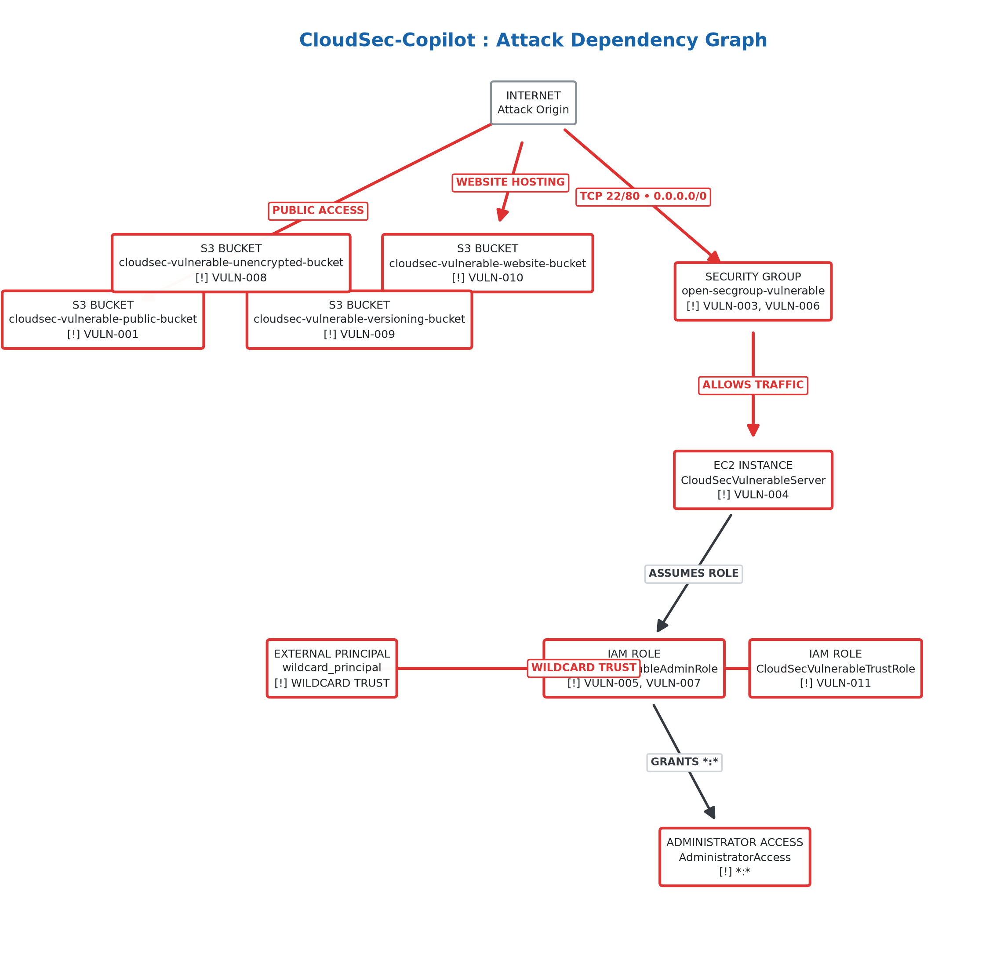

# CloudSec-Copilot

## An Intelligent Context-Aware Framework for Cloud Security Posture Optimization using Attack Graphs, Guardrailed AI, and Verified Reversible Remediation

[](cloudsec_copilot/tests)
[](pyproject.toml)
[](https://boto3.amazonaws.com/v1/documentation/api/latest/index.html)
[](https://networkx.org/)
[](docker-compose.yml)
[](LICENSE)

---

## Executive Summary

**CloudSec-Copilot** is a developer-centric, closed-loop Cloud Security Posture Management (CSPM) and remediation assistant delivered as a robust CLI application. It unifies **deterministic cloud discovery**, **multi-hop attack graph modeling**, **contextual risk prioritization**, **graph-grounded AI reasoning**, **pre-execution safety guardrails**, **real Boto3 automated remediation**, **immutable audit trails**, **100% reversible rollback**, and **post-remediation delta verification** into an integrated DevSecOps workflow.

> **Validation Status**: CloudSec-Copilot is validated in an authentic AWS-compatible **LocalStack** testbed running in Docker. The system executes authentic Boto3 AWS API calls against S3, IAM, EC2, Security Groups, SQS, and RDS with zero production risk and zero cloud costs.

Unlike traditional cloud scanners that stop at passive alert generation, CloudSec-Copilot explains the business impact of misconfigurations, analyzes toxic multi-resource combinations across graph paths, generates structured execution plans, enforces pre-execution safety filters, applies fixes after explicit human approval, and re-scans live assets to mathematically prove vulnerability removal.

---

## Demo Snapshot

CloudSec-Copilot constructs a directed multi-resource attack graph mapping lateral movement from unauthenticated internet entry points (`0.0.0.0/0`) through compute and identity layers to critical cloud assets:



*Generated by `cloudsec graph` using NetworkX and Matplotlib.*

---

## 1. Problem Statement & Motivation

Modern enterprise cloud infrastructure comprises deeply interconnected resources: IAM roles, S3 buckets, EC2 compute instances, Security Groups, SQS queues, and databases. In modern environments, catastrophic security incidents rarely stem from isolated bugs—they arise from **toxic combinations of misconfigurations**.

### Key Challenges in Traditional Cloud Security:
1. **Alert Fatigue**: Scanners flood security and engineering teams with hundreds of unprioritized, out-of-context alerts.
2. **Blindness to Toxic Combinations**: Single-resource scanners evaluate resources in isolation. They miss that a low-severity open port on an EC2 instance becomes critical when that instance has an attached IAM role with `AdministratorAccess` and access to an internal S3 data bucket.
3. **The Remediation Void**: Conventional scanners detect issues but leave remediation manual, slow, and error-prone.
4. **Autonomous AI Risks**: Giving generative AI unconstrained access to cloud APIs introduces severe operational hazards (hallucinated commands, destructive deletions). Without strict pre-execution guardrails and instant rollback mechanisms, automated remediation cannot be trusted.

---

## 2. Core Project Objectives

- **Automated Multi-Service Discovery**: Query live AWS/LocalStack endpoints (S3, IAM, EC2, SG, SQS, RDS) and normalize heterogeneous responses into strict Pydantic models.
- **Deterministic Vulnerability Detection**: Eliminate LLM hallucination in the detection layer through rigorous, rule-based security policies.
- **Attack Graph Construction**: Model lateral movement paths and privilege propagation using directed NetworkX multigraphs.
- **Contextual Risk Prioritization**: Rank findings on a dynamic 0.0–10.0 scale factoring base severity, direct internet ingress, administrative privilege, and graph blast radius.
- **Agentic AI Reasoning with Safety Guardrails**: Leverage OpenRouter LLMs (Claude 3.5 Sonnet / GPT-4o) with an `AISafetyValidator` that blocks destructive actions (`DeleteBucket`, `TerminateInstances`, etc.).
- **Human-in-the-Loop Remediation & Reversible Rollback**: Apply real Boto3 fixes with explicit user confirmation, snapshot pre-change states, and restore configurations on demand.
- **Post-Remediation Verification**: Re-scan target resources post-fix to mathematically verify vulnerability resolution.

---

## 3. End-to-End System Architecture

```
                      ┌────────────────────────────────────────┐
                      │    Cloud APIs (AWS / LocalStack)       │
                      └──────────────────┬─────────────────────┘
                                         │ Boto3 Metadata Collection
                                         ▼
                      ┌────────────────────────────────────────┐
                      │  Component 1: Discovery Engine         │
                      │  (collector.py + models.py)            │
                      └──────────────────┬─────────────────────┘
                                         │ Normalized CloudInventorySnapshot
                                         ▼
                      ┌────────────────────────────────────────┐
                      │  Component 2: Deterministic Scanner    │
                      │  (scanner.py - 7 active rules)         │
                      └──────────────────┬─────────────────────┘
                                         │ Raw Security Findings
                                         ▼
                      ┌────────────────────────────────────────┐
                      │  Component 3: Attack Graph Engine      │
                      │  (graph_builder.py - NetworkX)         │
                      └──────────────────┬─────────────────────┘
                                         │ Multi-Hop Traversal & Blast Radius
                                         ▼
                      ┌────────────────────────────────────────┐
                      │  Component 4: Risk Prioritization      │
                      │  (risk_engine.py - 0-10 Score Model)   │
                      └──────────────────┬─────────────────────┘
                                         │ Prioritized Findings & Graph Context
                                         ▼
                      ┌────────────────────────────────────────┐
                      │  Component 5: AI Reasoner & Planner    │
                      │  (ai_reasoner.py + remediation.py)     │
                      └──────────────────┬─────────────────────┘
                                         │ Structured Remediation Payload
                                         ▼
                      ┌────────────────────────────────────────┐
                      │  Component 6: AI Safety Validator      │
                      │  (safety_validator.py - Guardrails)    │
                      └──────────────────┬─────────────────────┘
                                         │ Validated Action & HITL Approval [y/N]
                                         ▼
                      ┌────────────────────────────────────────┐
                      │  Component 7: Remediation Executor     │
                      │  (executor.py - Boto3 Handlers)        │
                      └─────────┬────────────────────┬─────────┘
                                │                    │
             Pre-State Snapshot │                    │ Applied Boto3 Mutation
                                ▼                    ▼
       ┌───────────────────────────────┐   ┌───────────────────────────────┐
       │ Component 8 & 9: Audit Trail  │   │ Component 10: Verifier Engine │
       │ & Safe Rollback Subsystem     │   │ (verifier.py - Delta Scan)    │
       │ (audit_log.json + rollback)   │   └───────────────┬───────────────┘
       └───────────────┬───────────────┘                   │
                       │ One-Command Rollback              ▼
                       └──────────────────────► [ Verified Secure State ]
```

---

## 4. Component Deep Dive

### 1. Cloud Discovery Engine (`discovery/collector.py`, `models.py`)
- Interfaces directly with Boto3 service clients: S3, IAM, EC2, Security Groups, SQS, and RDS.
- Validates raw AWS responses into strongly-typed Pydantic data models (`CloudInventorySnapshot`).
- Handles missing or unconfigured services gracefully without synthetic mock data.

### 2. Deterministic Vulnerability Scanner (`scanner/scanner.py`)
Deterministic, zero-hallucination security rules inspect the inventory snapshot:

| Rule ID | Base Severity | Misconfiguration Condition | Target Asset |
| :--- | :---: | :--- | :--- |
| `RULE-S3-PUBLIC` | **CRITICAL** | Public ACL (`AllUsers`) or disabled Block Public Access. | S3 Buckets |
| `RULE-SG-OPEN` | **HIGH** | Ingress rule allows `0.0.0.0/0` on sensitive ports (22, 3389, 80). | Security Groups |
| `RULE-IAM-ADMIN` | **CRITICAL** | Overly permissive `AdministratorAccess` attached to role. | IAM Roles |
| `RULE-IAM-KEYS` | **HIGH** | Active, unrotated access keys older than 90 days. | IAM User Credentials |
| `RULE-SQS-PERMISSIVE` | **HIGH** | Queue policy grants `Principal: *` with broad actions. | SQS Queues |
| `RULE-RDS-PUBLIC` | **CRITICAL** | Database instance has `PubliclyAccessible=True`. | RDS Databases |
| `RULE-S3-UNENCRYPTED` | **MEDIUM** | Bucket lacks default server-side encryption configuration. | S3 Buckets |

### 3. Attack & Dependency Graph Engine (`graph/graph_builder.py`)
- Constructs a directed NetworkX multigraph $G = (V, E)$ modeling assets and trust relationships.
- Edge semantics: `EXPOSES_TO_INTERNET`, `ATTACHED_TO`, `ASSUMES_ROLE`, `CAN_READ_WRITE`, `PERMITS_INGRESS`.
- Traces multi-hop attack paths from public internet entry points to crown jewels.
- Computes reachable neighbor blast radius for every asset and exports `attack_graph.png` and `attack_graph.json`.

### 4. Contextual Risk Prioritization Engine (`risk_engine.py`)
Calculates a multi-factor contextual risk score on a 0.0–10.0 scale:
$$\text{Risk Score} = \min\left(10.0,\, S_{\text{base}} + E_{\text{ingress}}\,(+1.5) + P_{\text{admin}}\,(+1.5) + B_{\text{blast}}\,(+0.5/\text{node})\right)$$
Eliminates alert fatigue by prioritizing reachable, exploitable assets over isolated configurations.

### 5. AI Reasoning & Remediation Planner (`ai/ai_reasoner.py`, `remediation/remediation.py`)
- Leverages OpenRouter API (Claude 3.5 Sonnet / GPT-4o) with graph-grounded prompt injection.
- Automatically falls back to deterministic rule-based planning when offline.
- Generates structured plans: Root Cause, Business Impact, AWS CLI parameters, and Rollback specifications.

### 6. AI Safety Validator & Guardrails (`ai/safety_validator.py`)
- Mitigates autonomous AI risks through 4 pre-execution security gates:
  1. **Action Whitelisting**: Remediation action must exist in approved safe handlers.
  2. **Destructive Action Blacklist**: Hard block on `DELETE`, `TERMINATE`, `DROP`, or `PURGE` commands.
  3. **Resource Scope Matching**: Target ARN/ID must strictly match the scanned inventory.
  4. **Reversibility Guarantee**: Pre-execution state must be captured before execution is approved.

### 7. Remediation Execution Engine (`executor/executor.py`)
- Enforces Human-in-the-Loop (HITL) approval via interactive confirmation `[y/N]` or `--yes` flag.
- Provides `--dry-run` simulation mode to inspect changes before making live mutations.
- Real Boto3 remediation handlers:
  - S3: Applies `put_public_access_block` and sets bucket ACL to `private`.
  - Security Groups: Invokes `revoke_security_group_ingress` on `0.0.0.0/0` ingress rules.
  - IAM: Detaches `AdministratorAccess` and rebinds least-privilege policies.
  - SQS: Replaces wildcard `Principal: *` queue policies with restricted access controls.

### 8. Safe Rollback Subsystem
- Caches pre-execution state snapshots (ACL grants, ingress CIDRs, attached policy ARNs).
- Restores original configuration in seconds via `cloudsec rollback --id <VULN-ID>`.
- Closes the loop by verifying that rollback successfully restored the baseline configuration.

### 9. Immutable Audit Logging (`audit_log.json`)
- Structured JSON records for SOC2 and ISO 27001 compliance.
- Records timestamp, finding ID, risk score, approval status, pre-state, post-state, and verification result.
- Built-in regex sanitization automatically redacts sensitive API keys and tokens.

### 10. Post-Remediation Verification Engine (`verifier/verifier.py`)
- "Trust but verify" paradigm: Immediately re-scans the target resource after execution.
- Evaluates delta state: if the vulnerability is proven absent, marks status as `VERIFIED`.

---

## 5. Technology Stack

| Layer | Technology | Purpose |
| :--- | :--- | :--- |
| **Language** | Python 3.11 / 3.12 | Core application runtime |
| **CLI Framework** | Click + Rich | Interactive command-line interface & styled tables |
| **Cloud SDK** | Boto3 | AWS API integration for discovery and remediation |
| **Graph Intelligence** | NetworkX + Matplotlib | Attack graph modeling, path traversal & PNG rendering |
| **Data Validation** | Pydantic v2 | Strict JSON schema normalization & validation |
| **AI Reasoning** | OpenRouter API / LLM | Contextual root cause and impact reasoning |
| **Cloud Emulation** | LocalStack + Docker | Isolated, reproducible, zero-cost AWS testbed |
| **Quality Assurance** | pytest (100 tests) | Unit, graph integration, and remediation testing |

---

## 6. Quick Start & Complete Workflow Guide

### Prerequisites
- Python 3.11 or higher
- Docker & Docker Compose (for LocalStack)

---

### Step 1: Clone & Setup Environment

```bash
# Clone repository
git clone https://github.com/MeghanaKotharu25/CloudSec.git
cd CloudSec

# Create and activate virtual environment
python -m venv venv
# On Windows:
.\venv\Scripts\activate
# On Linux/macOS:
source venv/bin/activate

# Install dependencies
pip install -r requirements.txt
```

---

### Step 2: Start LocalStack (Docker)

Launch the isolated AWS emulator container in the background:

```bash
docker compose up -d
```
*LocalStack runs on `http://localhost:4566`, providing emulated S3, IAM, EC2, Security Groups, SQS, and RDS APIs.*

---

### Step 3: Seed Vulnerable Cloud Infrastructure

Provision realistic multi-resource misconfigurations (public S3 bucket, open SG 0.0.0.0/0, admin IAM role, permissive SQS queue, and stale keys):

```bash
python scripts/setup_vulnerable_lab.py
```

---

### Step 4: Run Automated Tests

> **Note**: Always execute `pytest` from the **repository root** so that the test discovery engine collects all test modules.

```bash
# Run all 100 unit, graph, remediation, and live LocalStack tests:
pytest -q
```

---

### Step 5: Discover Resources, Scan Misconfigurations & Rank Risks

Execute cloud discovery and deterministic scanning:

```bash
# Standard scan with styled Rich tables and contextual risk scores (0-10):
python -m cloudsec_copilot.cli.main scan

# Detailed scan with mathematical risk score formula breakdowns:
python -m cloudsec_copilot.cli.main scan --explain
```

---

### Step 6: Construct Attack Graph & Trace Lateral Paths

Build the multi-hop attack graph, compute blast radius, and export the visualization and JSON topology:

```bash
python -m cloudsec_copilot.cli.main scan --visualize attack_graph.png --graph-json attack_graph.json
```
- **`attack_graph.png`**: Visual graph rendered via NetworkX and Matplotlib showing entry points (`0.0.0.0/0`) reaching crown jewels.
- **`attack_graph.json`**: Structured node/edge adjacency list and detected attack paths.

---

### Step 7: Remediate Vulnerabilities

Remediation triggers the AI planning engine, validates safety guardrails, captures pre-execution state snapshots, and applies Boto3 fixes.

#### Option A: Remediate a Single Vulnerability (with Interactive Approval)
```bash
python -m cloudsec_copilot.cli.main fix --id VULN-001
```
*Prompts the user with `[y/N]` approval before modifying cloud infrastructure.*

#### Option B: Remediate a Single Vulnerability (Auto-Approve)
```bash
python -m cloudsec_copilot.cli.main fix --id VULN-001 --yes
```

#### Option C: Remediate All Detected Vulnerabilities at Once
```bash
python -m cloudsec_copilot.cli.main fix-all --yes
```
*Applies verified Boto3 fixes across all remediable findings in one execution, recording each action to `audit_log.json`.*

---

### Step 8: Post-Remediation Verification

Re-scan the cloud environment post-fix to mathematically confirm that vulnerabilities are removed:

```bash
python -m cloudsec_copilot.cli.main verify
```
*Performs a delta rescan against the previous snapshot and verifies that resolved findings no longer persist.*

---

### Step 9: Safe Reversible Rollback

Restore the exact pre-remediation configuration if an application requires the previous setting:

```bash
# Rollback a specific finding by ID:
python -m cloudsec_copilot.cli.main rollback --id VULN-001 --yes

# Or rollback the most recently applied remediation action:
python -m cloudsec_copilot.cli.main rollback --last --yes
```
*Reads `original_state` from `audit_log.json`, executes reverse Boto3 calls, and verifies state restoration.*

---

### Step 10: Export Audit & Security Reports

Export findings, attack graph summaries, and remediation history into compliance reports:

```bash
# Export Markdown report:
python -m cloudsec_copilot.cli.main report --format markdown --output scan_report.md

# Export HTML report:
python -m cloudsec_copilot.cli.main report --format html --output scan_report.html

# Export JSON report:
python -m cloudsec_copilot.cli.main report --format json --output scan_report.json
```

---

## 7. Automated Test Suite (100 Passing Tests)

Our test suite covers all components across unit and integration boundaries:

```bash
============================= test session starts =============================
collected 100 items

cloudsec_copilot/tests/test_discovery.py ......                          [  6%]
cloudsec_copilot/tests/test_phase1_detection.py ..........               [ 16%]
cloudsec_copilot/tests/test_phase2_graph_risk.py ...................     [ 35%]
cloudsec_copilot/tests/test_phase3_graph_integration.py ..............   [ 50%]
cloudsec_copilot/tests/test_phase3_new_vulns.py ...............          [ 65%]
cloudsec_copilot/tests/test_phase3_remediation.py ....................   [ 85%]
cloudsec_copilot/tests/test_security_pipeline.py ........                [ 93%]
tests/test_discovery.py ......                                           [100%]

============================ 100 passed in 15.53s =============================
```

---

## 8. Comparison with Existing Industry & Research Tools

| Feature | Prowler | Checkov | Defender + Copilot | Wiz / Orca | CloudSec-Copilot |
| :--- | :---: | :---: | :---: | :---: | :---: |
| **Deterministic Detection** | ✅ | ✅ | ✅ | ✅ | ✅ |
| **Live Runtime Inspection** | ✅ | ❌ | ✅ | ✅ | ✅ |
| **Attack Dependency Graph** | ❌ | ❌ | Partial | ✅ (Proprietary) | ✅ (Open NetworkX) |
| **Risk Scoring by Blast Radius** | ❌ | ❌ | Partial | ✅ | ✅ (0-10 Scale) |
| **AI Contextual Reasoning** | ❌ | ❌ | ✅ | ❌ | ✅ (OpenRouter) |
| **Pre-Execution AI Safety Gate** | ❌ | ❌ | ❌ | ❌ | ✅ (`AISafetyValidator`) |
| **Direct Boto3 Remediation** | ❌ | ❌ | Partial | Partial | ✅ (HITL Approved) |
| **Safe Reversible Rollback** | ❌ | ❌ | ❌ | ❌ | ✅ (State Caching) |
| **Post-Fix Delta Verification** | ❌ | ❌ | ❌ | ❌ | ✅ (`Verifier`) |
| **Immutable Redacted Audit Log** | ❌ | ❌ | Partial | ✅ | ✅ (`audit_log.json`) |
| **Zero-Cost Emulated Testbed** | ❌ | ❌ | ❌ | ❌ | ✅ (LocalStack) |

---

## 9. Academic References & Citations

1. **Prowler Cloud Security** (2026). Open-source security tool for AWS, Azure, GCP & Kubernetes.
2. **Palo Alto Networks** (2026). Checkov: Static Code Analysis for Infrastructure-as-Code.
3. **Microsoft Research** (2026). *Security Risks in Tool-Enabled AI Agents and Autonomous Execution*.
4. **TerraRepair** (2026). *A Tool-Grounded LLM Agent for Infrastructure-as-Code Repair*.
5. **InfraFix** (2025). *Technology-Agnostic Repair of Infrastructure as Code*.
6. **Wiz Security Platform** (2026). *Agentless Cloud Discovery and Security Graph Architecture*.

---

## 10. Contributors & Course Details

**Course**: `22AIE305` Introduction to Cloud Computing  
**Team**: C2  
- `CB.SC.U4AIE24220`
- `CB.SC.U4AIE24232`
- `CB.SC.U4AIE24241`
- `CB.SC.U4AIE24264`

**Repository**: [https://github.com/MeghanaKotharu25/CloudSec](https://github.com/MeghanaKotharu25/CloudSec)
